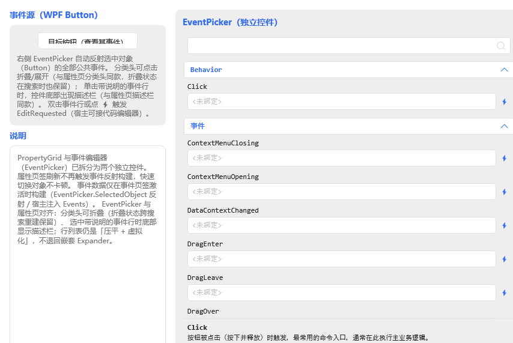
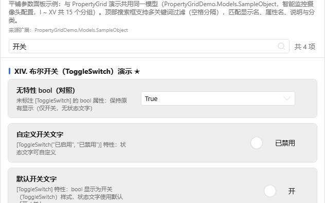
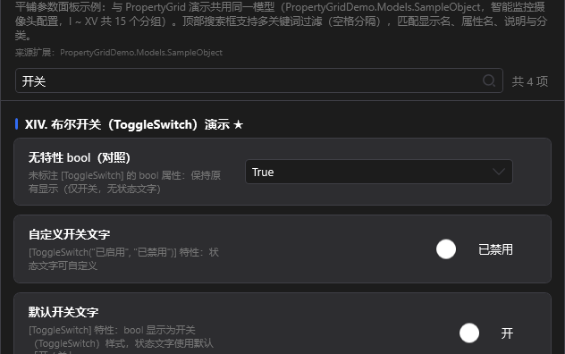
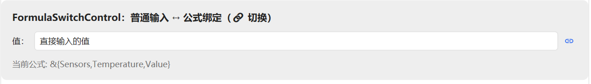
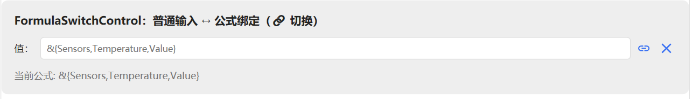
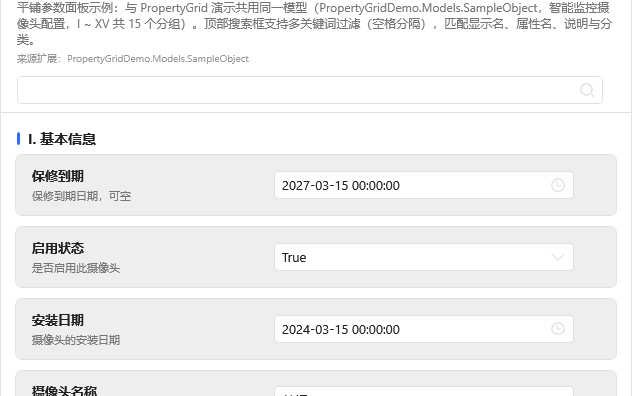
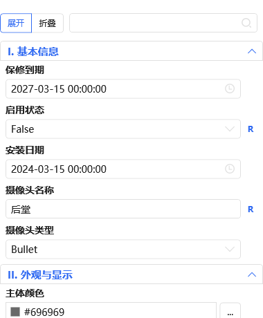

# PropertyGridDemo

[PropertyGridLib](https://www.nuget.org/packages/PropertyGridLib) 的官方演示项目 — WPF PropertyGrid 控件库，仿 WinForms PropertyGrid，基于 HandyControl UI 库。

> **作者：WangShuo** | 目标框架：`net48` / `net6.0-windows` / `net8.0-windows` / `net10.0-windows`（多目标）

## 项目介绍

本 Demo 以「智能监控摄像头配置」为场景，完整演示 PropertyGridLib 的全部编辑器类型与扩展机制：

| 演示分类 | 内容 |
|---------|------|
| I. 基本信息 | string / bool / enum / DateTime / 可空类型 |
| II. 外观与显示 | 颜色编辑器（`Color` / `Color?` / `SolidColorBrush`）、数值滑块 `[NumberSlider]` |
| III. 网络配置 | 常规类型编辑 |
| IV. 存储路径 | 文件选择 `[FilePath]`、文件夹选择 `[DirectoryPath]` |
| V. 高级配置 | TypeConverter 下拉列表、多选列表 `[MultiSelect]` |
| VI. 检测区域 | 复杂对象展开编辑（内嵌 PropertyGrid） |
| VII. 集合编辑器 | 简单类型集合、复杂对象集合 `[CollectionEditor]` |
| VIII. 字典编辑器 | 简单键值、复杂对象值、嵌套字典自动弹窗 |
| IX. 公式绑定 | `FormulaBound<T>` + `[FormulaEditor]`，树形绑定源选择 |
| X. 操作按钮 | `[Button]` 命令按钮 + 反射调用 + 全局点击事件 |
| XI. 宿主扩展编辑器 | `RegisterEditor<TAttr>` 自定义「数值 + 单位下拉」编辑器 |
| XII. 只读与隐藏 | `[ReadOnly]` / `[Browsable(false)]` |
| XIII. 自然排序 | 属性排序演示 |
| XIV. 布尔开关 | `[ToggleSwitch]` 布尔开关（默认文字 / 自定义文字 / 仅开关不显示文字） |
| XV. 多行文本与类型 | `[MultilineText]` 多行富文本编辑、`Type` 类型属性（只读展示 / 类型选择） |

演示程序提供两个窗口，绑定同一个示例模型 `SampleObject`，便于对比：

| 窗口 | 说明 |
|------|------|
| `MainWindow` | `PropertyGrid` 基础控件：分类树 + 搜索 + 描述栏 + 主题 / 语言 / 字号切换 |
| `PropertyGridProDemoWindow` | `PropertyGridPro` 平铺参数面板：卡片式属性行、头部信息区、统一编辑器宽度 |

另有 `CollectionEditorDemoWindow`（标题「控件独立使用演示」），演示集合编辑器、字典编辑器与公式绑定控件**脱离 `PropertyGrid` 单独嵌入窗口**的用法。


此外还演示了：

- **深色 / 浅色主题切换**（HandyControl `Theme.Skin`，面板配色与控件硬编码色一并跟随主题）
- **中英文双语切换**（`IPropertyLocalization` + `LocalizationManager`）
- **全局字体 / 字号设置**（PropertyGrid 内所有弹窗编辑器同步跟随）
- **控件独立使用**：集合编辑器、字典编辑器、公式绑定控件脱离 PropertyGrid 单独嵌入窗口
- **无限嵌套子属性**（卡片式布局 + 层级引导线）
- **布尔开关特性** `[ToggleSwitch]`（滑块开关 + 可定制状态文字）

---

## v1.6.0 更新要点

| 变更 | 说明 |
|------|------|
| 「重置所有属性」闪退修复 | 颜色编辑器行内色块改绑控件独占画刷（不再每次新建/释放画刷），修掉连点重置时 `SolidColorBrush.ReleaseOnChannelCore` 抛 `0x8000FFFF` 导致 Demo 退出；虚拟化开 60 轮、关 30 轮、Pro 30 轮压测全过 |
| 复杂对象值区友好显示 | 未重写 `ToString()` 的嵌套配置类不再显示 `命名空间.类名` 全名，改显去命名空间的友好类型名；类型上的 `[DisplayName]` 优先；重写了 `ToString()` 的输出不变 |
| 多层嵌套可逐层展开 | 第二层及更深层此前点箭头无反应（子项事件未冒泡到网格），现可逐层展开任意深度 |
| 浮点数值不再显示长尾数 | double/float 按有效数字（G15/G7）显示，`1.2000000000000002 → 1.2`、`0.1+0.2 → 0.3`；底层值不变 |
| 公式绑定「打开即已绑定」 | 公式已有内容时默认进入已绑定状态：`FormulaSwitchControl` 默认公式模式；`[FormulaEditor]` 属性行默认展开公式条 |
| 集合/字典编辑器列表随属性刷新 | 在内嵌属性页改了条目属性（名称/选项）后，左侧列表行显示文本即时重算；只刷显示、不动数据与选中项 |
| 去除行内修改红点 | 紧凑布局（TitlePlacement=Left）属性名旁的红色「已修改」圆点移除，仅保留行尾 `R` 复位按钮这一个标识 |
| 事件页对齐属性页 | `EventPicker` 分类头可折叠（折叠状态跨搜索重建保留）、选中带说明的事件行时底部出现描述栏；列表仍是「压平 + 虚拟化」 |
| 分类头改用面板色 | 分类头 Expander 显式取 `RegionBrush`（浅色皮肤=白、深色皮肤=深色面板），不再用默认的 `SecondaryRegionBrush` 灰带 |
| 多 .NET 目标 | Demo 与库都支持多目标：Demo 为 `net48` / `net6.0-windows` / `net8.0-windows` / `net10.0-windows`，库为上述 + `netcoreapp3.0/3.1` / `net7.0-windows`；NuGet 包随附全部程序集 |
| .NET 10 运行时 | 自包含发布产物位于 `publish/net10-win-x64/`，目标机器无需预装 .NET |

事件页（`EventPicker`）：分类头可折叠，选中带说明的事件行时底部出现描述栏 ——



分类头底色取自主题面板色（浅色皮肤为白、深色皮肤为深色面板，不再是一条突兀的灰带）：

| 浅色 | 深色 |
|---|---|
|  |  |

## v1.5.0 更新要点

| 变更 | 说明 |
|------|------|
| 修复 FormulaSwitchControl 重叠 | 「普通输入 ↔ 公式绑定」切换控件在公式模式下双输入框叠在一起，现改为随 `IsFormulaMode` 互斥显隐 |
| 新增 EventPicker 独立事件编辑器演示 | `EventPickerDemoWindow`：脱离 `PropertyGrid` 单独嵌入的事件选择控件 |
| XV. 多行文本与类型分组 | `[MultilineText]` 多行富文本编辑、`Type` 类型属性只读展示 |

FormulaSwitchControl 两种状态（修复后无重叠）：

| 普通输入模式 | 公式绑定模式 |
|---|---|
|  |  |

## v1.3.0 更新要点

| 变更 | 说明 |
|------|------|
| 新增 `PropertyGridPro` 演示窗口 | 平铺参数面板、卡片式行布局、头部信息区、统一编辑器宽度 |
| 新增 XIV. 布尔开关分组 | `[ToggleSwitch]` 特性三种用法（默认文字 / 自定义文字 / 仅开关） |
| 卡片式布局与主题色跟随 | 面板内硬编码深色改为主题资源键，浅色 / 深色双向切换正常 |
| 无限嵌套样式统一 | 子属性按层级缩进 + 引导线，各层级间距与圆角统一 |
| 公式绑定接入 Pro 面板 | `[FormulaEditor]` 属性在 Pro 面板同样显示公式绑定区 |
| 复位按钮常驻占位 | 未悬停时保留占位，同行编辑器不再左右跳动 |
| 清理旧模型 | 移除旧演示模型与右侧「实时值」区块，Pro 窗口改用共用的 `SampleObject` |

效果截图：

| 卡片式行布局 | 多级嵌套（浅色） | 布尔开关（浅色） | 复位按钮占位 |
|---|---|---|---|
|  |  |  |  |

> 完整使用文档见 [skill/SKILL.md](skill/SKILL.md)（快速开始 / 特性清单 / 编辑器类型 / 主题与多语言 / 公式绑定 / PropertyGridPro / 示例模型 / FAQ）。

## 运行

```bash
git clone https://github.com/1wangshuo/PropertyGridDemo.git
cd PropertyGridDemo
dotnet build PropertyGridDemo.csproj
```

用 Visual Studio 2022 打开 `PropertyGridDemo.csproj` 直接 F5 运行即可。

## 相关链接

| 资源 | 地址 |
|------|------|
| **控件库（NuGet）** | https://www.nuget.org/packages/PropertyGridLib |
| **使用文档（技能文档）** | [skill/SKILL.md](skill/SKILL.md) |
| **NuGet 包** | `Install-Package PropertyGridLib -Version 1.6.0` |

```xml
<PackageReference Include="PropertyGridLib" Version="1.6.0" />
```

## 许可证

MIT License
