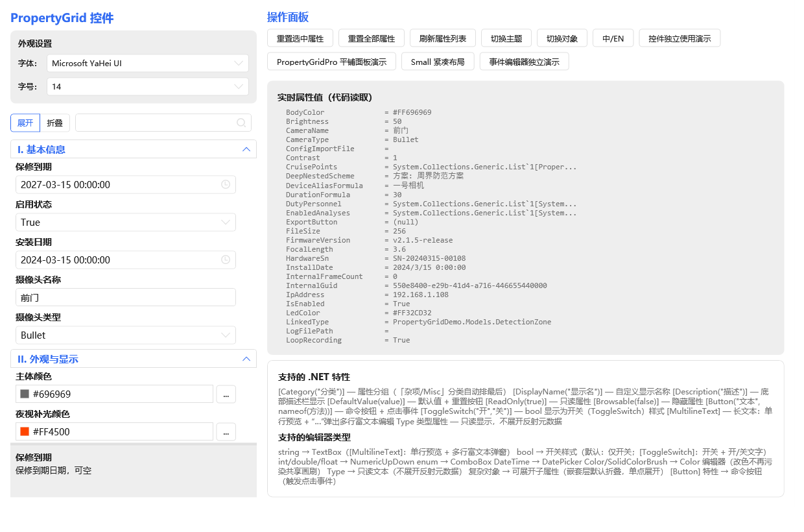
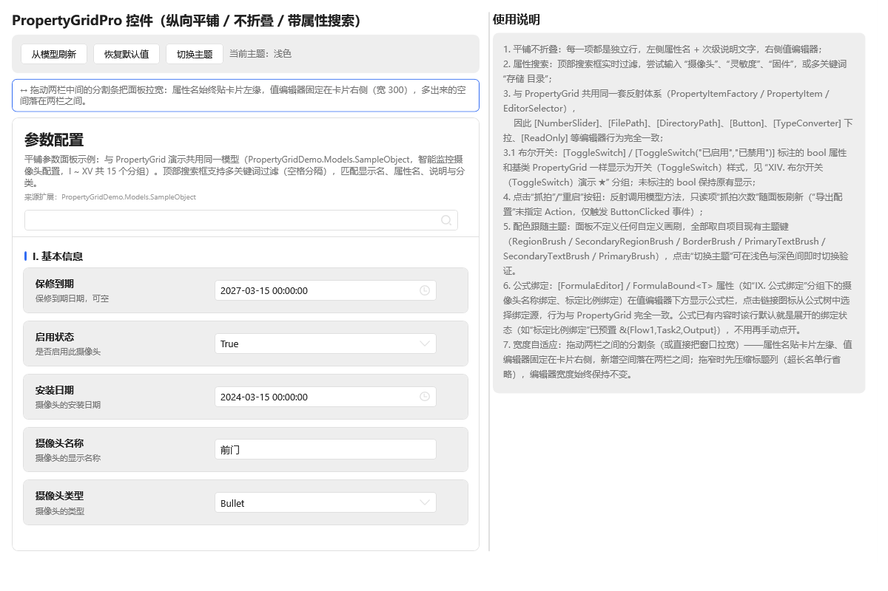

# PropertyGridLib 技能文档（v1.8.0）

> WPF PropertyGrid 控件库 **PropertyGridLib** 与官方演示程序 **PropertyGridDemo** 的多页使用文档入口。
>
> 版本：**1.8.0** ｜ 更新日期：2026-10-30 ｜ 作者：WangShuo ｜ 许可：MIT



---

## 一、按需求找文档

| 我想…… | 看这一页 |
|--------|---------|
| 5 分钟把控件跑起来 | [01 快速开始与基础用法](01-快速开始与基础用法.md) |
| 知道有哪些特性（Attribute）、分别怎么用 | [02 特性清单](02-特性清单.md) |
| 搞清某个类型的属性会渲染成什么编辑器 | [03 编辑器类型总览](03-编辑器类型总览.md) |
| 让控件跟随深色/浅色主题与中英文切换 | [04 主题与多语言](04-主题与多语言.md) |
| 实现公式绑定（变量引用 + 树形选择器） | [05 公式绑定](05-公式绑定.md) |
| 用「平铺参数面板」PropertyGridPro | [06 PropertyGridPro 平铺参数面板](06-PropertyGridPro-平铺参数面板.md) |
| 看看演示程序展示了什么、直接抄示例代码 | [07 示例模型与演示场景](07-示例模型与演示场景.md) |
| 排查问题 / 查已知限制 | [08 常见问题 FAQ](08-常见问题-FAQ.md) |

---

## 二、项目构成

| 目录 / 工程 | 类型 | 说明 |
|------------|------|------|
| `PropertyGridLib/` | WPF 类库（NuGet 包） | 控件本体：`PropertyGrid`、`PropertyGridPro`、8 个自定义特性、集合/字典/公式/颜色等编辑器与对话框 |
| `PropertyGridDemo/` | WPF 演示程序（多目标：`net48` / `net6.0-windows` / `net8.0-windows` / `net10.0-windows`） | 「智能监控摄像头配置」示例模型（I ~ XV 共 15 个分组）+ 4 个演示窗口 |
| `PropertyGridDemo/skill/` | 文档 | 本技能文档与 `skill/images/` 截图资源（随演示仓库一并发布） |
| `nuget/` | 产物 | 本地构建的 `PropertyGridLib.*.nupkg` / `.snupkg`（已加入 `.gitignore`，不上传仓库） |

**运行环境要求**

| 项目 | 要求 |
|------|------|
| 目标框架（类库） | `net48`、`netcoreapp3.0`、`netcoreapp3.1`、`net6.0-windows`、`net7.0-windows`、`net8.0-windows`、`net10.0-windows` |
| UI 依赖 | [HandyControl](https://github.com/HandyOrg/HandyControl) 3.5.1（已通过 Costura.Fody 内嵌，宿主无需单独附带） |
| 开发环境 | Visual Studio 2022 / .NET SDK 6.0+（演示程序多目标，跑 net48 需装 .NET Framework 4.8 开发工具，跑 net10 需 .NET 10 SDK） |

---

## 三、安装

```powershell
# Package Manager Console
Install-Package PropertyGridLib -Version 1.6.0
```

```bash
# CLI
dotnet add package PropertyGridLib --version 1.6.0
```

```xml
<PackageReference Include="PropertyGridLib" Version="1.6.0" />
```

> 离线部署：直接引用 `PropertyGridLib.dll` 即可，HandyControl、System.Text.Json 等依赖已内嵌进单一 DLL。

---

## 四、5 分钟上手

```xml
<!-- 1. 声明命名空间 -->
<Window xmlns:pg="clr-namespace:PropertyGridLib;assembly=PropertyGridLib">
    <!-- 2. 放置控件 -->
    <pg:PropertyGrid x:Name="propertyGrid"
                     ShowSearchBar="True"
                     ShowDescription="True"/>
</Window>
```

```csharp
// 3. 绑定任意配置对象（属性自动按类型/特性选择编辑器）
propertyGrid.SelectedObject = new MyConfig();
```

```csharp
// 4. 重置与刷新
propertyGrid.ResetSelectedToDefault();   // 重置当前选中属性
propertyGrid.ResetAllToDefault();        // 重置全部属性到初始值
propertyGrid.RefreshProperties();        // 重新反射对象、刷新列表
```

---

## 五、PropertyGrid 与 PropertyGridPro 怎么选

| 对比项 | `PropertyGrid` | `PropertyGridPro` |
|--------|----------------|-------------------|
| 布局形态 | 分类 + 可折叠树形层级（仿 WinForms） | 纵向**平铺**、顶层不折叠的参数面板 |
| 行样式 | 通栏式属性行 | **卡片式**属性行（圆角、行间距、分类头） |
| 属性搜索 | 有 | 有，附**匹配计数**与空结果提示 |
| 头部区 | 无 | 有（`Header` / `HeaderDescription` / `SourceText`） |
| 编辑器宽度 | 随行自适应 | `EditorWidth` 统一控制 |
| 适用场景 | 常规配置编辑、层级复杂、需要折叠收纳 | 参数面板 / 属性面板 / 平铺展示，追求扫读效率 |
| 特性与编辑器体系 | 两者**完全共用**（同一套 Attribute、编辑器模板、本地化、主题） | 同左 |



---

## 六、版本与更新记录

| 版本 | 日期 | 要点 |
|------|------|------|
| **1.8.0** | 2026-10-30 | 新增范围滑块（`RangeValue` / `[RangeSlider]` / `RangeSliderControl` 独立使用，拖动气泡显示区间）；复位按钮 R 固定占位；文件夹树视觉升级 + 右键新建/重命名/删除；绑定源键名与类型提示中间省略；界面文本补齐多语言 |
| 1.6.0 | 2026-10-15 | 修掉「重置所有属性」连续点击闪退（颜色编辑器色块改绑控件独占画刷）、复杂对象值区改显友好类型名、多层嵌套可逐层展开、浮点数值不再显示长尾数、公式绑定默认进入已绑定态、集合/字典编辑器列表随属性刷新、去除行内修改红点、事件页分类折叠 + 底部描述栏、分类头改用面板色；新增 `net10.0-windows` 目标 |
| 1.5.0 | 2026-10-14 | 修复 `FormulaSwitchControl` 在公式模式下普通输入框与公式输入框重叠的问题；新增 `EventPicker` 独立事件编辑器演示窗口 |
| 1.4.0 | 2026-09-24 | 属性列表 UI 虚拟化（重建 206ms → 8ms）；新增 `ShowEventsPage` 事件页能力、`EnableVirtualization` / `TitlePlacement` / `TitleFontWeight` / `CategoryFontWeight` 开关 |
| **1.3.0** | 2026-09-15 | 新增 `PropertyGridPro` 平铺参数面板、卡片式行布局、主题色跟随、无限嵌套样式统一、公式绑定接入、复位按钮常驻占位、`[ToggleSwitch]` 布尔开关；清理演示旧模型；新增本套技能文档 |
| 1.2.0 | 2026-09-07 | 已发布版本 |

完整更新日志见 [PropertyGridLib/README.md](../../PropertyGridLib/README.md#更新日志)。

---

## 七、截图资源说明

本套文档所有配图存放于 `skill/images/`（相对本页为 `images/`），文档内统一以相对路径 `images/xxx.png` 引用；演示程序 README 以 `skill/images/xxx.png` 引用，控件库 README 以 `../PropertyGridDemo/skill/images/xxx.png` 引用。截图均来自实际运行的控件（浅色 / 深色主题各一套），文件名规则：

| 前缀 | 含义 |
|------|------|
| `propertygrid-main-*` | 基础 `PropertyGrid` 完整窗口 |
| `pro-overview-*` / `pro-search-*` | `PropertyGridPro` 完整窗口 / 搜索过滤 |
| `pro-nested-*` / `pro-card-layout-*` | Pro 面板嵌套子属性 / 卡片式行布局细节 |
| `pro-theme-follow-*` | Pro 面板主题色跟随对比 |
| `toggle-switch-*` | `[ToggleSwitch]` 布尔开关（整区、单行、开/关状态） |
| `reset-button-*` | 复位按钮常驻占位（基础 / Pro，浅色 / 深色） |
| `formula-binding-*` / `formula-tree-popup-*` | 公式绑定区与公式树弹窗 |
| `event-picker-*` | `EventPicker` 事件页（分类折叠 + 底部描述栏） |
